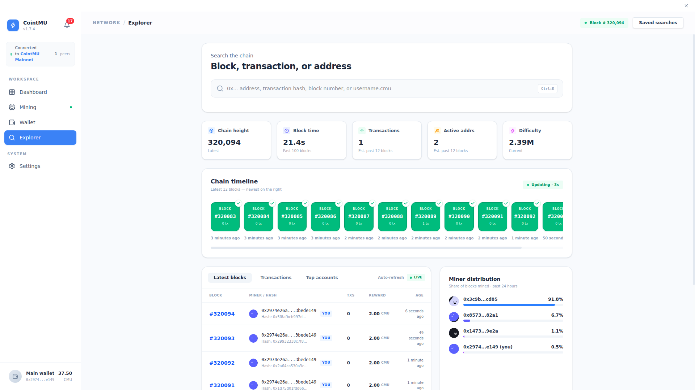

# Explorer

The Explorer provides a real-time, transparent view of every block, transaction, and address participating in the CointMU network. It serves as the primary tool for on-chain inspection, network monitoring, and development debugging.

## Universal Search

The search bar at the top of the page is the primary navigation tool for querying on-chain data.

| Input Type       | Description                                                                                   |
| ---------------- | --------------------------------------------------------------------------------------------- |
| Address          | Query the balance and transaction history of any wallet address (`0x` and 40 hex characters). |
| Transaction Hash | Look up a specific transaction, or a block, by its hash (`0x` and 64 hex characters).         |
| Block Number     | Navigate directly to a block by its height.                                                   |

Any other input is ignored without a message. Up to 1.7.4 the placeholder also offered `username.cmu`, which was never supported; since 1.8.0 it reads *0x... address, transaction hash, or block number*.

::: tip
Use `Ctrl+K` (`Cmd+K` on macOS, not tested there) to focus the search bar while the Explorer is open. The **Saved searches** button, which did nothing, was removed in 1.8.0.
:::

## Network Telemetry

A real-time snapshot of the network's current operational state.

| Metric       | Description                                                                                                |
| ------------ | ---------------------------------------------------------------------------------------------------------- |
| Chain Height | The latest block number confirmed and appended to the chain.                                               |
| Block Time   | Average time to solve and validate the past 100 blocks (e.g., `14.9s`).                                    |
| Transactions | Estimated transaction throughput over the past 12 blocks.                                                  |
| Active Addrs | Count of unique addresses that have interacted with the chain recently, estimated over the past 12 blocks. |
| Difficulty   | Current cryptographic threshold required to mine a new block (e.g., `1.19M`).                              |

## Chain Timeline

The Chain Timeline displays the 12 most recent blocks as a live visual feed, with the newest block on the right.

Each block card shows:

- Block number (e.g., `#5686`).
- Transaction count for that block.
- Time elapsed since the block was mined.

The timeline auto-refreshes every 3 seconds (`Updating - 3s`) by polling the embedded RPC node directly. When the node is offline, it shows *Node is offline* instead.

## Latest Blocks, Transactions, and Top Accounts

The bottom panel provides tabbed access to granular on-chain data.

| Tab           | Description                                                                                   |
| ------------- | --------------------------------------------------------------------------------------------- |
| Latest Blocks | Lists recent blocks with miner address, block hash, transaction count, block reward, and age. |
| Transactions  | Raw transaction feed across the network.                                                      |
| Top Accounts  | Addresses ranked by CMU balance, useful for monitoring network distribution.                  |

The Latest Blocks view tags your local node's address as **YOU** for quick identification of self-mined blocks. Top Accounts also shows each address's share of the supply. The **Auto-refresh** switch above the tabs turns live updates of these lists on (**Live**) or off.

## Block, Transaction, and Address Details

Selecting a block, transaction, or address (or searching for one) opens its detail view. **Back** returns to the Explorer.

- **Block:** height, status, timestamp, hash and parent hash, miner, nonce, difficulty, size, gas used and limit, extra data (also as ASCII), the block reward, and the block's transactions.
- **Transaction:** status and confirmations, block, timestamp, sender and recipient, value, gas price and gas used, fee, nonce, and input data.
- **Address:** whether it is a contract, an account (EOA) or your own wallet, balance, a 30-day balance trend, first and last seen, and recent transactions. These come from the recent block window, not from a full index.

## Miner Distribution

The Miner Distribution panel displays the share of blocks mined by each address. Since 1.8.0 you choose the range: **Week** (the past 7 days, the default), **Month** (the past 30 days) or **All time**. Up to 1.7.4 it always covered the past 24 hours.

This chart is useful for monitoring network decentralization and identifying dominant mining addresses on the private chain.

The chart reads a local block index, not the node directly. CointMU keeps the number, hash, parent, time and miner of every block in `<userData>/explorer-index/<chain ID>` (see [Where Data Is Stored](/docs/app/installation#where-data-is-stored)). The index starts at the newest block, follows new ones, and fills in older blocks back to the first one in the background, pausing while the node syncs. The panel reads it every 5 seconds.

| Message                                               | Meaning                                                                      |
| ----------------------------------------------------- | ---------------------------------------------------------------------------- |
| *Indexing blocks · N% · partial data*                 | The index has not reached the start of the range yet; the chart is partial.  |
| *No blocks indexed in this range yet*                 | Nothing in the range is indexed yet.                                         |
| *Node unreachable · showing blocks indexed up to #N*  | The node does not answer; the chart keeps what was indexed.                  |
| *Block index unavailable*                             | The index cannot be read.                                                    |

If the chart looks wrong, **Settings → General → Explorer cache → Reset…** deletes the index and rebuilds it from your node in the background. Your wallet and chain data are not touched; see [Settings → General](/docs/app/settings#general).

The range buttons, the indexing message and the reset were seen on the Linux 1.8.0 build. The other messages come from the source.
