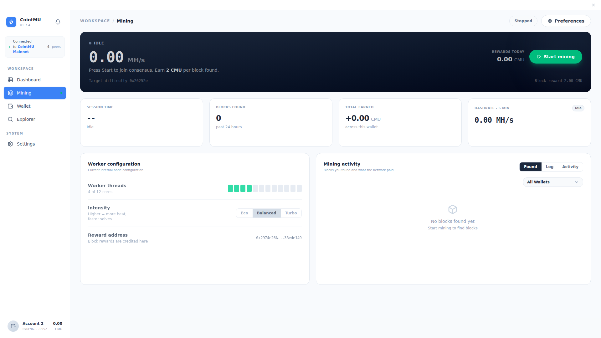

# Mining

The Mining page is the dedicated control center for participating in CointMU network consensus. It shows the local miner's state, hashrate and rewards, and the worker configuration set in [Settings → Mining](/docs/app/settings#mining).

## Consensus Control

The main banner displays the current mining state and provides the primary start/stop control.

| Element           | Description                                                                                                                                                             |
| ----------------- | ----------------------------------------------------------------------------------------------------------------------------------------------------------------------- |
| Status            | `Mining`, `Stopped`, `Paused (Battery)`, `Paused: you are active` or `Paused: outside schedule` in the header; the banner shows `Idle`, `Initializing` or the hashrate. |
| Hashrate          | Real-time computational output in MH/s.                                                                                                                                 |
| Target Difficulty | Current network difficulty target (e.g., `0x123957`).                                                                                                                   |
| Block Reward      | Fixed reward per block found (e.g., `2 CMU` per block).                                                                                                                 |
| Rewards Today     | Total CMU earned in the current session.                                                                                                                                |
| Start Mining      | Primary action button to join or leave the network consensus.                                                                                                           |

Where CointMU shows a tray icon (see [Settings → General](/docs/app/settings#general)), the tray menu also has **Start mining** and **Stop mining**. *(source-only)*

When mining starts, Geth may first need to generate its DAG; meanwhile the banner shows *Generating Directed Acyclic Graph (DAG) for verification...* until it is done. While the node is still syncing, the banner shows the sync progress and an estimate of the time left. With no peers, it shows a hint instead, such as *Bootnode unreachable — make sure you are connected to the campus network or VPN.* See [Troubleshooting](/docs/app/node#troubleshooting).

## Performance Metrics

Four telemetry cards track historical and current mining performance.

| Metric           | Description                                                                             |
| ---------------- | --------------------------------------------------------------------------------------- |
| Session Time     | Duration of the current active mining session.                                          |
| Blocks Found     | Total valid blocks mined in the past 24 hours.                                          |
| Total Earned     | Aggregate CMU rewards accumulated across the lifetime of the connected wallet.          |
| Hashrate - 5 Min | Five-minute moving average of computational output, used to monitor hardware stability. |

## Worker Configuration

The Worker Configuration panel shows how the local machine allocates hardware to mining. It is read-only here; change the values in [Settings → Mining](/docs/app/settings#mining).

| Setting        | Description                                                                                                   |
| -------------- | ------------------------------------------------------------------------------------------------------------- |
| Worker Threads | Number of CPU threads the miner uses (e.g., `4 of 12 cores`). The default is 4.                               |
| Reward Address | The wallet address where block rewards are credited upon a successful solve. It defaults to your main wallet. |

To reduce heat and CPU load, lower the number of worker threads, or turn on **Low priority** in [Settings → Mining](/docs/app/settings#mining) so other programs come first. The **Intensity** row (`Eco`, `Balanced`, `Turbo`) is gone since 1.8.0; it never changed how the miner ran.

## When Mining Runs

Mining you started — on this page, from the tray, or at launch — can pause by itself and resume later. Three settings in [Settings → Mining](/docs/app/settings#mining) decide when. They are checked in this order, and the first that applies names the pause in the header:

| Setting                              | Pauses mining                                                                                                                              | Header                     |
| ------------------------------------ | ------------------------------------------------------------------------------------------------------------------------------------------ | -------------------------- |
| Pause on battery (on by default)     | While a laptop runs on battery. Mining resumes on AC power.                                                                                | `Paused (Battery)`         |
| Mine on a schedule (off by default)  | Outside the hours you set, in local time (default 22:00 to 07:00). The end may be after midnight; the same start and end means all day.    | `Paused: outside schedule` |
| Mine only when idle (off by default) | While you use the computer. Mining resumes once the computer has been idle for the time you choose: 1, 2, 5, 10 or 15 minutes (default 2). | `Paused: you are active`   |

These settings only pause and resume mining you started; they never start it, and with mining stopped they do nothing. While the schedule or idle-only is on and mining is started, the app checks them every 15 seconds.

The settings and their choices were seen on the Linux 1.8.0 build. Mining was not started for these docs, so pausing and resuming come from the source, and the battery pause was not tested on a laptop.

## Start Mining at Launch

Since 1.8.0, **Start mining at launch** in [Settings → Mining](/docs/app/settings#mining) starts mining by itself, once per session. It is off by default, and the option is shown only while **Enable Mining** is on. *(source-only)*

Mining starts 30 seconds after all of these hold: the node answers, has at least one peer and is not syncing; a reward address is set; and the laptop is not on battery with **Pause on battery** on. During those 30 seconds a banner says *Mining starts in … s* with **Cancel**, also on the lock screen, and a desktop notification appears. If a condition is lost during the countdown, it waits again.

**Cancel**, starting or stopping mining yourself, or turning the setting off ends the automatic start for the rest of the session. Mining needs only the reward address, not an unlocked wallet. Once started, the [pause rules above](#when-mining-runs) apply as usual.

::: warning
Mining uses your CPU, about 2 GB of memory for the DAG, and battery. Leave **Start mining at launch** off on a computer you share or carry around.
:::

## Mining Activity

The Mining Activity panel provides a detailed ledger of consensus participation and block rewards.

| Tab      | Description                                                                                       |
| -------- | ------------------------------------------------------------------------------------------------- |
| Found    | Blocks successfully found by the local miner, with block height, hash, timestamp, and CMU reward. |
| Log      | Node activity as it happens: blocks synced from the network and blocks you sealed.                |
| Activity | Heatmap of accepted shares over the past 30 days.                                                 |

Use the **All Wallets** dropdown to filter the activity ledger by a specific account.

When a block is mined to your reward address or one of your accounts, CointMU sends a *Block mined* notification, unless mining events are turned off in [Settings → Notifications](/docs/app/settings#notifications). Since 1.8.0 this works on every page of the app; before, only while the Mining page was open. Blocks mined before the app started watching are not announced. *(source-only)*
