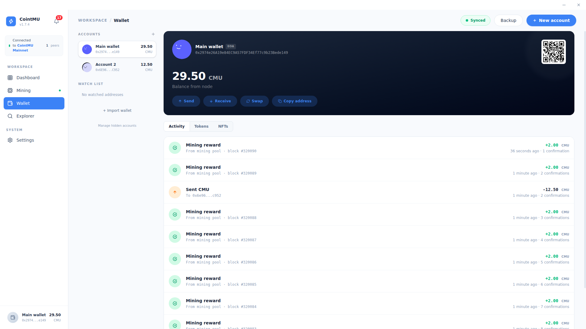

# Wallet

The Wallet page provides a comprehensive interface for managing local Externally Owned Accounts (EOA). It serves as the primary gateway for signing transactions, monitoring balances, and interacting with the CointMU network across multiple accounts.

## Creating or Importing a Wallet

On first start, CointMU offers **Create New Wallet** or **Import Wallet**.

- **Create New Wallet** shows a 12-word recovery phrase. Write it down; then set a password of at least 8 characters.
- **Import Wallet** restores a wallet from a 12-word recovery phrase, a raw private key, or an encrypted keystore JSON file.

The password encrypts your keys on this computer. You enter it again (**Unlock**) whenever the app starts or the wallet locks. The wallet locks after a time without activity that you choose in [Settings → Security](/docs/app/settings#security): 15 minutes on a new install. Since 1.8.0 it also locks while mining; mining and the node keep running.

## Account Sidebar

The left sidebar allows you to organize and switch between multiple accounts.

| Element                | Description                                                                                                                                                      |
| ---------------------- | ---------------------------------------------------------------------------------------------------------------------------------------------------------------- |
| Accounts               | Quick-switch list of active local accounts, showing truncated addresses and current CMU balances. **+** adds the next account derived from your recovery phrase. |
| Import Wallet          | Add an account from a recovery phrase, a private key, or an encrypted JSON keystore file.                                                                        |
| Manage Hidden Accounts | Show hidden accounts again, or delete them. Deleting an account that still holds a small balance asks for confirmation.                                          |

## Account Detail Panel

The main panel displays the full details of the currently selected account.

| Element       | Description                                                                                                                          |
| ------------- | ------------------------------------------------------------------------------------------------------------------------------------ |
| Account Name  | Display name and EOA badge identifying the account type.                                                                             |
| Full Address  | Complete address. **Receive** shows it with a QR code.                                                                               |
| Live Balance  | CMU balance fetched directly from the local node (e.g., `9,076.06 CMU`), with the decimals set in Settings → Appearance.             |
| Quick Actions | **Send**, **Receive** and **Copy address**. The **Swap** button, which did nothing, was removed in 1.8.0, along with the Watch List. |

A copied address is cleared from the clipboard after 30 seconds by default, unless you copied something else meanwhile; see [Settings → Security](/docs/app/settings#security). With **Privacy mode** on, balances and amounts show as `••••`; see [Settings → Appearance](/docs/app/settings#appearance).

### Send

**Send** transfers CMU or a token you track. Choose the asset, enter the recipient and amount (**Max** fills in your available balance), and check the estimated network fee before **Review & Sign**. The fee is always paid in CMU, so sending a token also needs some CMU. After sending, the dialog shows the transaction hash, and a notification follows when the transaction is confirmed or fails.

Since 1.8.0 the dialog also has a **Wallet password** field: every send needs your wallet password, which is checked on this computer and never stored. A wrong password stops the send before anything is signed. To send without typing it, turn off **Ask for password to send** in [Settings → Security](/docs/app/settings#security). The field was seen on the Linux 1.8.0 build; no transaction was sent for these docs.

## Activity, Tokens, and NFTs

The tabbed panel below the account detail provides a complete view of on-chain assets and history.

**Activity**

A chronological ledger of all transactions associated with the selected account. Each entry shows the transaction type, source block, amount, timestamp, and confirmation count.

**Tokens**

A portfolio view of the ERC-20 tokens you track for the active address. Use **Add Token** with a token's contract address to track it; the app reads the token's details from the contract and refuses addresses that are not ERC-20 contracts on this network. Token balances are resolved via the embedded node without requiring an external indexer.

**NFTs**

A gallery of ERC-721 and ERC-1155 tokens held by the active address, found by scanning the chain's transfer events.

## Global Controls

| Control     | Description                                                                                                                                                |
| ----------- | ---------------------------------------------------------------------------------------------------------------------------------------------------------- |
| Synced      | *Synced* while the app can reach the local node, *Offline* when it cannot, like the Dashboard header. Up to 1.7.4 it always said *Synced*.                 |
| Backup      | Opens [Settings → Security](/docs/app/settings#security), where the backups are. Up to 1.7.4 it did nothing.                                               |
| New Account | Opens the import dialog (recovery phrase, private key, or JSON keystore). To create a new account from your own recovery phrase, use **+** in the sidebar. |

## Backing Up

Backups live in [Settings → Security](/docs/app/settings#security):

- **Recovery phrase** shows your 12 words after you enter your password.
- **Export keystore** saves the active account as an encrypted JSON keystore, protected by your wallet password. Other wallets can import it with that password.
- **Reveal private key** shows one account's raw private key after you enter your password.

The phrase and the key hide themselves again after a few seconds.

::: warning
The recovery phrase and the private key give full control of your funds. Store them offline and never share them. The keystore file is encrypted, but anyone who also knows your password can open it.
:::
