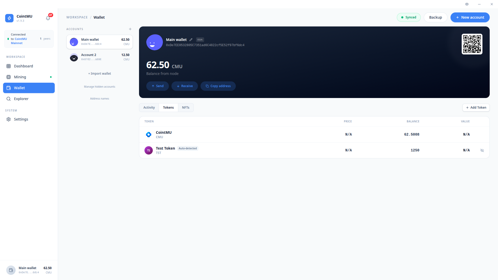

# Wallet

The Wallet page provides a comprehensive interface for managing local Externally Owned Accounts (EOA). It serves as the primary gateway for signing transactions, monitoring balances, and interacting with the CointMU network across multiple accounts.

## Creating or Importing a Wallet

On first start, CointMU offers **Create New Wallet** or **Import Wallet**.

- **Create New Wallet** shows a 12-word recovery phrase. Write it down; then set a password of at least 8 characters.
- **Import Wallet** restores a wallet from a 12-word recovery phrase, a raw private key, or an encrypted keystore JSON file.

The password encrypts your keys on this computer. You enter it again (**Unlock**) whenever the app starts or the wallet locks. The wallet locks after a time without activity that you choose in [Settings → Security](/docs/app/settings#security): 15 minutes on a new install. Since 1.8.0 it also locks while mining; mining and the node keep running.

## Account Sidebar

The left sidebar allows you to organize and switch between multiple accounts.

| Element                | Description                                                                                                                                                                                     |
| ---------------------- | ----------------------------------------------------------------------------------------------------------------------------------------------------------------------------------------------- |
| Accounts               | Quick-switch list of active local accounts, showing truncated addresses and current CMU balances. **+** adds the next account derived from your recovery phrase.                                |
| Import Wallet          | Add an account from a recovery phrase, a private key, or an encrypted JSON keystore file.                                                                                                       |
| Manage Hidden Accounts | Show hidden accounts again, or delete them. Deleting an account that still holds a small balance asks for confirmation. Hidden tokens are listed here too, each with a button to show it again. |
| Address Names          | Names for other addresses, kept on this computer. See [Address Names](#address-names). Since 1.9.3.                                                                                             |

## Account Detail Panel

The main panel displays the full details of the currently selected account.

| Element       | Description                                                                                                                                                             |
| ------------- | ----------------------------------------------------------------------------------------------------------------------------------------------------------------------- |
| Account Name  | Display name and EOA badge identifying the account type. Since 1.9.3, **Rename account** (the pencil) changes the name: 1 to 32 characters. The address stays the same. |
| Full Address  | Complete address. **Receive** shows it with a QR code.                                                                                                                  |
| Live Balance  | CMU balance fetched directly from the local node (e.g., `9,076.06 CMU`), with the decimals set in Settings → Appearance.                                                |
| Quick Actions | **Send**, **Receive** and **Copy address**. The **Swap** button, which did nothing, was removed in 1.8.0, along with the Watch List.                                    |

A copied address is cleared from the clipboard after 30 seconds by default, unless you copied something else meanwhile; see [Settings → Security](/docs/app/settings#security). With **Privacy mode** on, balances and amounts show as `••••`; see [Settings → Appearance](/docs/app/settings#appearance).

### Send

**Send** transfers CMU or any token with a balance, in two steps (since 1.9.0):

1. **The form.** Choose the asset, enter the recipient and the amount, and check the estimated network fee, then **Continue**. The amount is taken exactly, in the asset's own decimals. **Max** fills in your CMU balance minus the estimated fee, or a token's whole balance. If you gave the recipient a [name](#address-names), it shows under the address as *Saved as* and the name.
2. **Confirm send.** A summary of the sender, the full recipient address, the asset (and token contract), the amount, the fee and the total. It is never masked by Privacy mode. Enter your **Wallet password** and choose **Confirm & Send**, or **Back** to change the form.

The fee is always paid in CMU, so sending a token also needs some CMU. After sending, the dialog shows the transaction hash, and a notification follows when the transaction is confirmed or fails.

Every send needs your wallet password (since 1.8.0), which is checked on this computer and never stored. A wrong password keeps you on the confirm step, with the field cleared, before anything is signed. To send without typing it, turn off **Ask for password to send** in [Settings → Security](/docs/app/settings#security).

On the Linux 1.9.3 build the form showed *Saved as* with a saved name, and **Continue**. The test wallet had no balance, so **Continue** stayed disabled and the confirm step comes from the source. No transaction was sent for these docs.

## Activity, Tokens, and NFTs

The tabbed panel below the account detail provides a complete view of on-chain assets and history.

**Activity**

A chronological ledger of all transactions associated with the selected account. Each entry shows the transaction type, source block, amount, timestamp, and confirmation count. Since 1.9.1 a token send shows as *Sent* and the token symbol, and since 1.9.3 an address you named shows its name before the short address.

**Tokens**

A portfolio view of the ERC-20 tokens of the active address, with CMU first. Use **Add Token** with a token's contract address to track it; the app reads the token's details from the contract and refuses addresses that are not ERC-20 contracts on this network. Token balances are resolved via the embedded node without requiring an external indexer.

Since 1.9.1, tokens sent to your accounts are also found on their own. A background scan reads each account's transfers from block 0, then follows new blocks; found tokens with a balance appear marked *Auto-detected*, at most 200 per account. While the first scan runs, the tab shows its progress (*Looking for tokens sent to this account…*). *(The scan is source-only: the test node had no blocks.)*

Click a token for its details: contract address, balance, and a warning that anyone can create a token copying another's name, so check the contract address. From there you can:

- **Hide token**, also the button at the end of its row. Hidden tokens are listed in **Manage Hidden Accounts**, where each can be shown again.
- Set a **Logo**: a PNG, JPEG or WebP image up to 2 MB (not SVG), cropped to 128×128 and kept only on this computer. **Reset to default** removes it. Custom logos are kept for at most 250 assets.

CMU keeps its official logo and cannot be hidden; its details show only the balance. This was seen on the Linux 1.9.3 build; hiding a token and logos come from the source.

**NFTs**

A gallery of ERC-721 and ERC-1155 tokens held by the active address. Since 1.9.2 (ERC-721) and 1.9.3 (ERC-1155) they are found by the same background scan as tokens, and ownership is checked against the contract. At most 50 NFTs per contract and 500 per account are tracked. Metadata and images are fetched by the app over `https://` (`ipfs://` through `https://ipfs.io/ipfs/`), only from public addresses, with images up to 5 MB. *(source-only)*

## Address Names

Since 1.9.3, **Address names** in the account sidebar lets you name addresses you send to or receive from. Enter the **Address** and a **Name** of 1 to 32 characters, then **Save name**; saved names can be edited or removed in the same list. Names are labels on this computer only: a send always goes to the full address, and a name is never turned into an address.

A named address shows its name in the Send form (*Saved as*), on the confirm step, and in the Wallet and Dashboard activity. Your own accounts cannot be named here (*This is one of your accounts. Rename it on the account card.*); use **Rename account** instead. Names with invisible formatting characters, such as a right-to-left mark, are refused.

On the Linux 1.9.3 build a name was saved and listed with the address in lowercase, and the Send form showed it as *Saved as*. Naming one of the wallet's own addresses, and a name with a right-to-left mark, were refused. The right-to-left mark gets the same message as a wrong length, *Enter a name of 1 to 32 characters.*

## Global Controls

| Control     | Description                                                                                                                                                |
| ----------- | ---------------------------------------------------------------------------------------------------------------------------------------------------------- |
| Synced      | *Synced* while the app can reach the local node, *Offline* when it cannot, like the Dashboard header. Up to 1.7.4 it always said *Synced*.                 |
| Backup      | Opens [Settings → Security](/docs/app/settings#security), where the backups are. Up to 1.7.4 it did nothing.                                               |
| New Account | Opens the import dialog (recovery phrase, private key, or JSON keystore). To create a new account from your own recovery phrase, use **+** in the sidebar. |

## Backing Up

Backups live in [Settings → Security](/docs/app/settings#security):

- **Recovery phrase** shows your 12 words after you enter your password.
- **Export keystore** saves the active account as an encrypted JSON keystore, protected by your wallet password. Other wallets can import it with that password.
- **Reveal private key** shows one account's raw private key after you enter your password.

The phrase and the key hide themselves again after a few seconds.

::: warning
The recovery phrase and the private key give full control of your funds. Store them offline and never share them. The keystore file is encrypted, but anyone who also knows your password can open it.
:::
